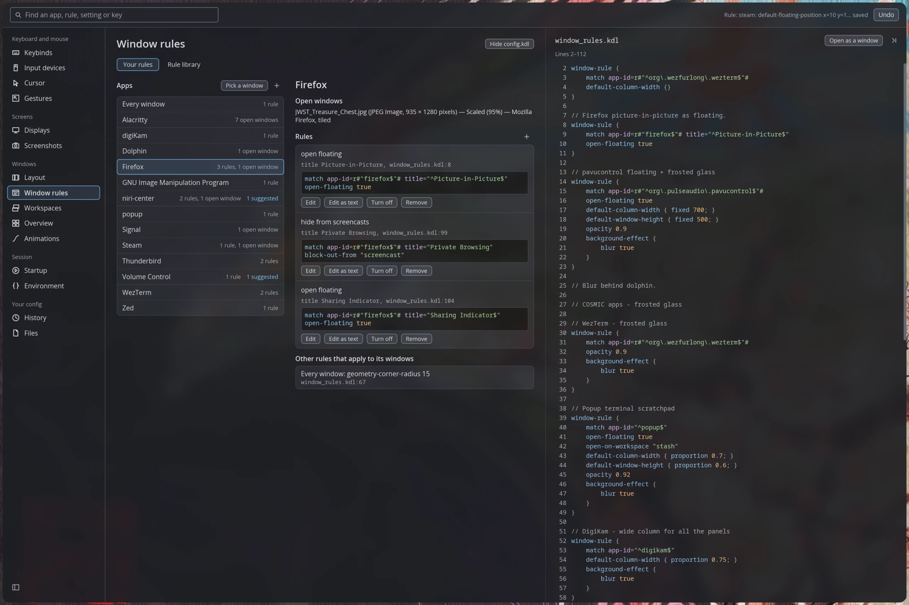
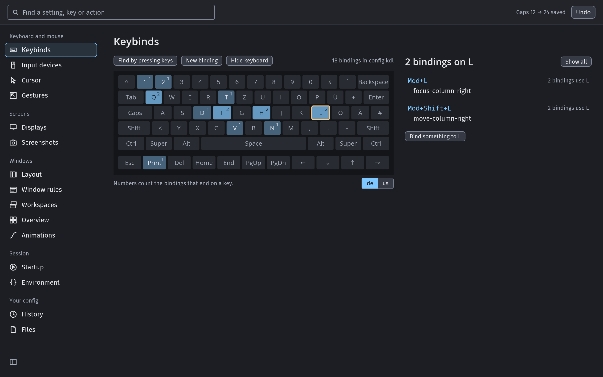
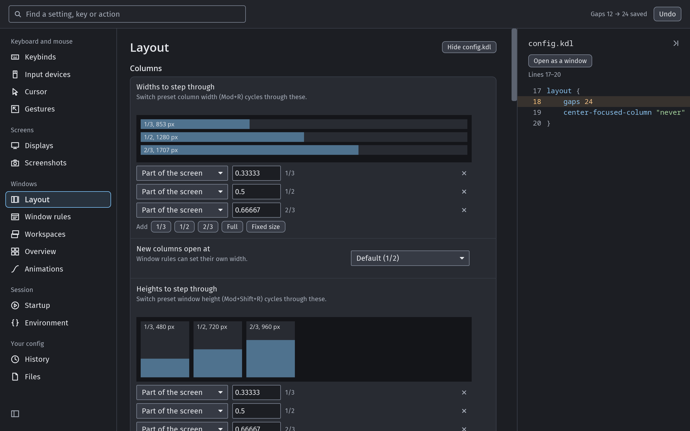
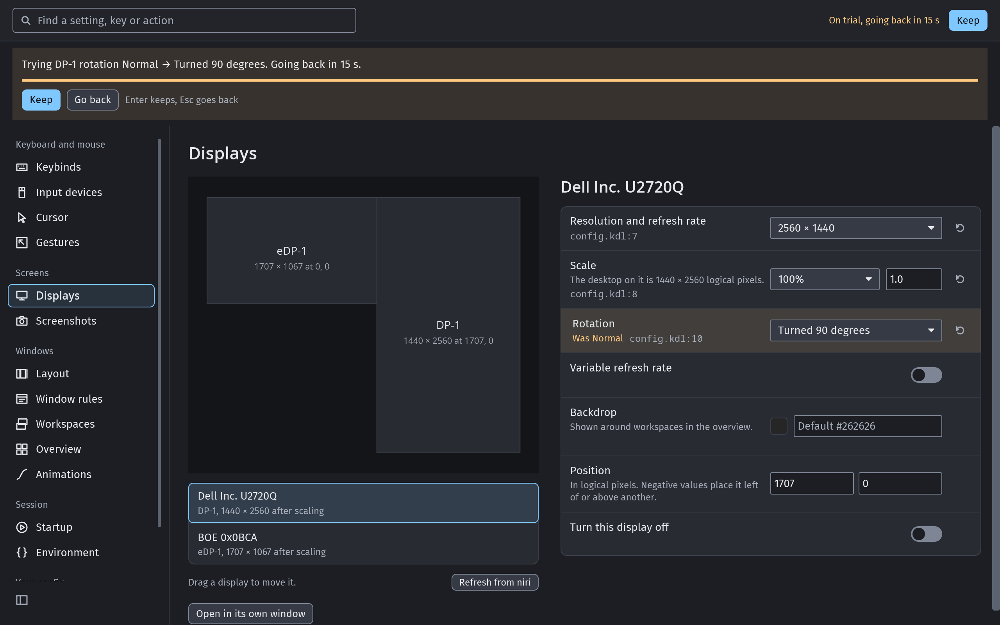
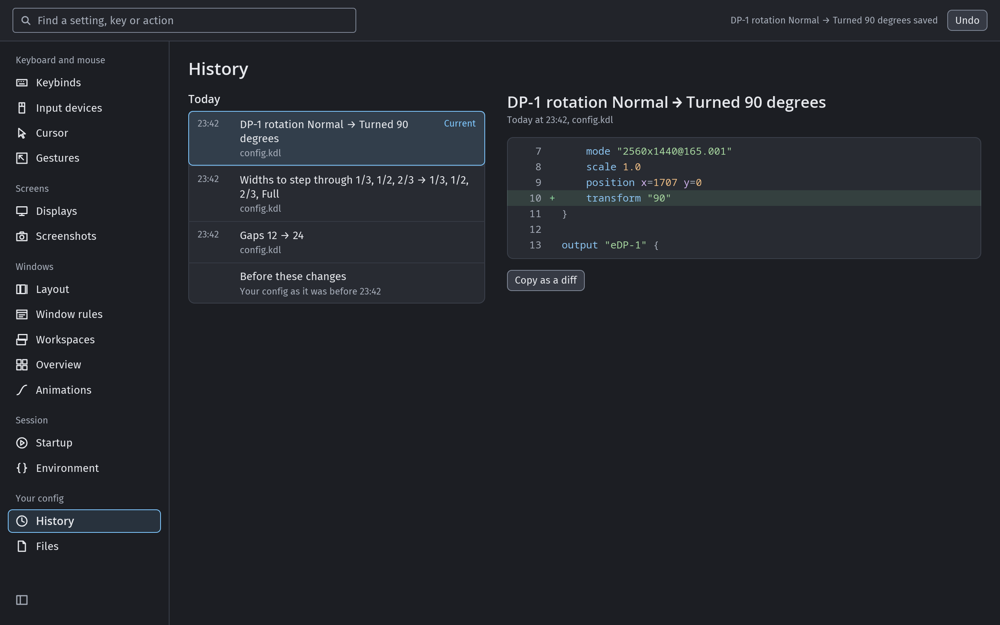
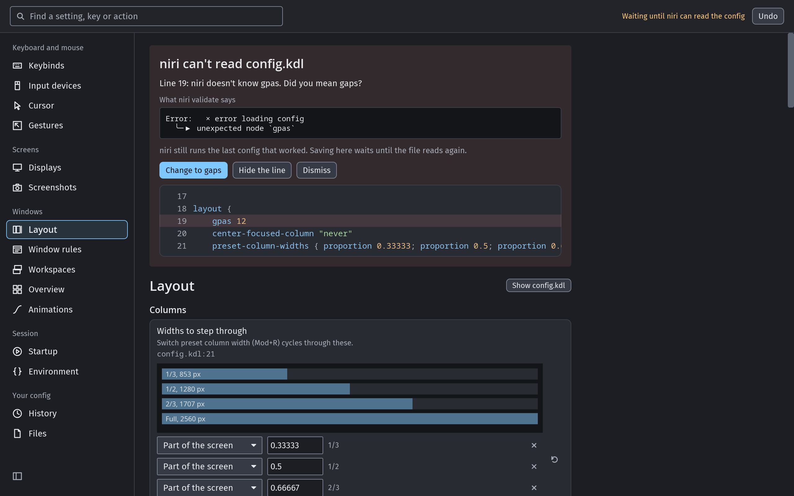
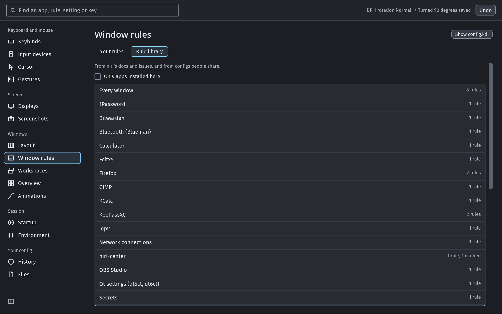

# niri-center

**Settings for the [niri](https://github.com/niri-wm/niri) Wayland
compositor that leave your config file the way you wrote it.**

niri is configured in a text file. niri-center gives that file a settings
app: keybinds, displays, window rules, layout, animations, input and more,
each on a page of its own. Every change lands in your `config.kdl` (or the
file it includes) as a small edit, so your comments, your layout and the
blocks other tools write stay exactly as they were.

[](https://felintusun.github.io/niri-center/?page=rules)

**[Try it in your browser](https://felintusun.github.io/niri-center/)**: the
app itself, running on niri's default config. Change anything and open
History to see the exact edit. Nothing leaves the page.

## What it does

- **Your file stays yours.** No reformatting, ever: niri-center changes the
  text it has to and nothing else. Comments, blank lines and blocks written
  by shells like Noctalia or DankMaterialShell survive untouched.
- **niri checks every change first.** A change is saved a moment after you
  make it, once `niri validate` accepts it. If niri turns it down, nothing is
  written and you see niri's own words.
- **Undo and history.** Every change, yours or one made in your editor, is a
  version you can look at as a diff and go back to. Ctrl+Z always works.
- **Display changes are tried first.** A new resolution, scale, rotation or
  position goes back by itself after 15 seconds unless you keep it.
- **Window rules by app.** Every app with rules or open windows in one list;
  pick one to see its windows, its rules, the rules that reach it from
  elsewhere, and ready-made rules for it from a built-in library.
- **Keybinds on your keyboard.** Your bindings drawn on a keyboard in your
  layout; press a key to find what is bound to it.
- **Fixes what niri cannot read.** When an edit elsewhere breaks the
  config, niri-center shows where, offers the fix for a misspelled name, and
  brings your editor to the front.
- **Made for niri.** It fits a half or third of the screen, follows your
  dark, light and high-contrast settings, finds any setting as you type,
  and leaves niri's Mod shortcuts alone. Any page can run as a window of its
  own: `niri-center --pane displays`.
- **Sandboxed.** It can write only to your niri config folder and its own
  files (Landlock), and it has no network code.

## Screens

| | |
|---|---|
|  |  |
|  |  |
|  |  |

## Install

niri-center works with niri 26.04. You need [Rust](https://rustup.rs); the
repository picks its toolchain itself:

```sh
git clone https://github.com/felintusun/niri-center
cd niri-center
cargo install --path niri-center-ui
```

That installs `niri-center`. To open a page from a niri shortcut:

```kdl
Mod+Shift+P { spawn "niri-center" "--pane" "displays"; }
```

`dist/` has launcher entries for the app and for the Displays and Keyboard
Shortcuts pages; copy them to `~/.local/share/applications/`.

## Status

An unofficial, early project. It edits settings rather than files: the part
of your config a page changes shows beside it, read-only, and only a window
rule can be edited as text. There is no screen-reader support yet
(`docs/ADR-accessibility.md`).

It re-imagines [NiriMod](https://github.com/srinivasr/nirimod) and
[niri-settings](https://github.com/stefonarch/niri-settings) from scratch in
Rust, with [iced](https://iced.rs).

## Contributing

`CONTRIBUTING.md` covers building, testing and the code rules; the decisions
behind the app are in `docs/`.

## License

GPL-3.0-or-later. Third-party licenses are in `THIRD_PARTY_LICENSES.md`.
